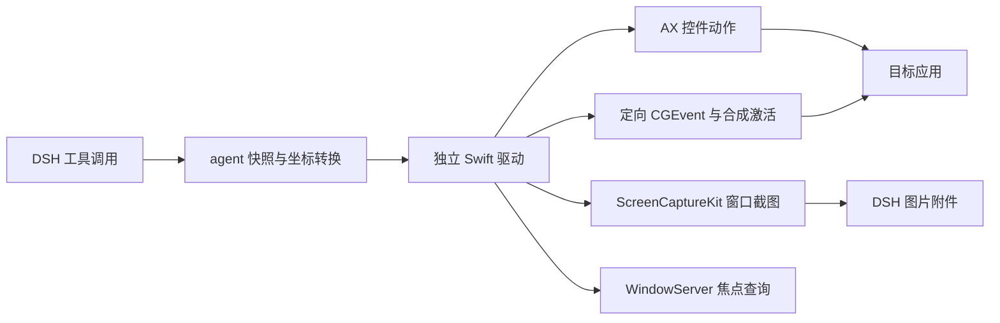

# 后台操作的实现范围

插件由 DSH 工具适配层和一个独立 Swift 进程组成。两者通过私有子进程的 stdin、stdout 交换逐行 JSON，没有共享 socket，也没有访问 Codex 的文件或进程。

简单的元素点击优先选择 AXPick 或 AXPress。坐标点击构造带窗口编号的 NSEvent，设置 CGEvent 的窗口字段 91、92 和窗口内坐标，最后向目标 PID 投递。后台鼠标事件带 Command 标志，不移动系统指针。

键盘输入先建立目标应用的虚拟激活状态。应用激活通知不足以让 NSApp 拥有 key window，因此驱动还投递 subtype 为 3 的窗口激活鼠标事件。驱动记住已经建立的窗口状态，并通过 AX 通知使失效状态过期，避免每次按键重复激活窗口。

文字通过显式 UTF-16 载荷的键盘事件投递，快捷键通过键码和修饰键变化事件投递。驱动不依赖当前布局找到全部文字键位。该机制已经验证中文、表情和组合字符，但不等同于完整的输入法组合、硬件键盘模拟或跨应用兼容承诺。

截图使用桌面独立窗口的 ScreenCaptureKit filter，按截图像素比例标注元素位置。最小化和离屏窗口直接拒绝，观察函数没有 AXRaise、取消最小化或激活目标的步骤。

焦点监视器在输入期间查询前台程序与 WindowServer 键盘焦点。它在后台目标取得系统焦点时中止后续事件，不能保证提前阻止每次变化。用户切换到其他程序时，定向操作继续，变化保留在返回记录中。同一前台进程中另一个窗口的输入目前拒绝执行，因为只保住进程 PID 无法证明用户原窗口的输入状态没被改变。

## 与研究对象的差异

本实现包含 AX 语义操作、定向窗口事件、合成激活、虚拟状态维护、Unicode 文字事件、窗口截图、焦点监视和异常恢复。

本实现没有复刻 Codex 的全部全局焦点事件过滤，也没有暂停 WindowServer 显示更新或调用其私有离屏捕获后端。因此这是独立的后台驱动首版，不能视作 Codex 原生服务的完整兼容实现。

私有接口通过系统库的 `dlsym` 解析，仅使用 `_AXUIElementGetWindow`、`CGEventSetWindowLocation`、`CPSGetKeyFocusProcess` 和连接初始化。缺少必要接口时，相关后台输入返回错误。私有接口没有跨 macOS 版本的稳定性保证。

代码入口为 `index.js`、`lib/tools.js`、`lib/driver.js` 与 `native/main.swift`。AX 观察位于 `native/Observation.swift`，输入与焦点维护位于 `native/Input.swift`，私有 ABI 封装位于 `native/Bridge.c`。
